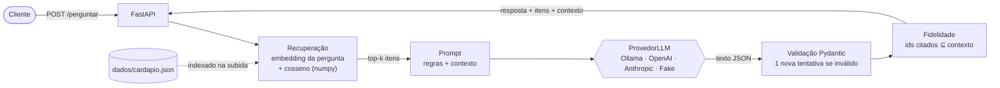

<h1 align="center">cardapio-rag</h1>

<p align="center">
  <b>API em Python que responde perguntas sobre um cardápio usando RAG: busca semântica + LLM com saída em JSON validado.</b><br>
  Roda 100% local e de graça (embeddings locais + Ollama), com avaliação automatizada e CI.
</p>

<p align="center">
  <a href="https://github.com/blackoutt444/cardapio-rag/actions/workflows/ci.yml"></a>
  
  
  
</p>

> Projeto de estudo de engenharia de aplicações com LLM. O cardápio (4 restaurantes, 51 itens) é fictício e foi criado só para este projeto.

## O que ele faz

Você pergunta em linguagem natural ("tem hambúrguer vegano?") e a API:

1. **recupera** os itens do cardápio mais parecidos com a pergunta (embeddings + similaridade de cosseno);
2. manda esses itens como **contexto** para um LLM, com a instrução de responder só com base neles;
3. exige a resposta em um **JSON com schema definido**, valida com Pydantic e tenta de novo se vier inválido;
4. confere se o LLM só citou itens que estavam no contexto (**fidelidade**) e descarta o que não estava.


## Arquitetura



| Arquivo | Responsabilidade |
| --- | --- |
| [`cardapio_rag/dados.py`](cardapio_rag/dados.py) | Carrega e valida o cardápio; define o texto de cada item que vira embedding |
| [`cardapio_rag/embeddings.py`](cardapio_rag/embeddings.py) | `EmbedderE5` (semântico, sentence-transformers) e `EmbedderHash` (lexical, para testes e baseline) |
| [`cardapio_rag/indice.py`](cardapio_rag/indice.py) | Busca vetorial em memória com filtros de preço e tag |
| [`cardapio_rag/prompt.py`](cardapio_rag/prompt.py) | Prompt do sistema e formatação do contexto |
| [`cardapio_rag/llm.py`](cardapio_rag/llm.py) | Interface `ProvedorLLM` e as implementações Ollama, OpenAI, Anthropic e Fake |
| [`cardapio_rag/assistente.py`](cardapio_rag/assistente.py) | O pipeline: recuperar → gerar → validar → checar fidelidade |
| [`cardapio_rag/api.py`](cardapio_rag/api.py) | Rotas `/saude`, `/buscar` e `/perguntar` |
| [`cardapio_rag/metricas.py`](cardapio_rag/metricas.py) | hit@k e reciprocal rank |
| [`avaliacao/avaliar.py`](avaliacao/avaliar.py) | Roda as perguntas de referência e calcula as métricas |

## Como executar

Pré-requisitos: Python 3.12+ e [Ollama](https://ollama.com/download).

```bash
python -m venv .venv
source .venv/bin/activate        # Windows: .venv\Scripts\activate
pip install -r requirements-embeddings.txt -r requirements-dev.txt
ollama pull qwen2.5:3b
uvicorn cardapio_rag.api:app --reload
```

Na primeira subida o modelo de embeddings (~470 MB) é baixado do Hugging Face. Depois disso, a documentação interativa fica em http://localhost:8000/docs.

```bash
curl "http://localhost:8000/buscar?q=sobremesa&preco_max=20&tag=vegano"

curl -X POST http://localhost:8000/perguntar \
  -H "Content-Type: application/json" \
  -d '{"pergunta": "Tem algum hambúrguer vegano?"}'
```

### Configuração

| Variável | Padrão | Descrição |
| --- | --- | --- |
| `LLM_PROVEDOR` | `ollama` | `ollama`, `openai`, `anthropic` ou `fake` |
| `LLM_MODELO` | depende do provedor | `qwen2.5:3b` no Ollama |
| `OLLAMA_URL` | `http://localhost:11434` | Endereço do Ollama |
| `OLLAMA_NUM_GPU` | o Ollama decide | Camadas do modelo na GPU; `0` roda só na CPU (veja a seção de latência) |
| `OPENAI_API_KEY` / `ANTHROPIC_API_KEY` | — | Só se usar esses provedores |
| `EMBEDDINGS` | `e5` | `e5` (semântico) ou `hash` (lexical, sem download) |
| `EMBEDDINGS_MODELO` | `intfloat/multilingual-e5-small` | Qualquer modelo E5 do Hugging Face |
| `TOP_K` | `5` | Itens recuperados como contexto |

### Docker

```bash
docker build -t cardapio-rag .
docker run -p 8000:8000 --add-host=host.docker.internal:host-gateway cardapio-rag
```

O container fala com o Ollama da máquina host. Para testar sem LLM nem download de modelo: `-e LLM_PROVEDOR=fake -e EMBEDDINGS=hash`.

### Testes

```bash
pytest -v
ruff check .
```

Os testes não usam rede nem modelo: o LLM é o `ProvedorFake`, os embeddings são os lexicais (`EmbedderHash`) e as APIs da OpenAI, da Anthropic e do Ollama são simuladas com `httpx.MockTransport`. O CI roda lint, testes (Python 3.12 e 3.13), a avaliação da busca lexical e o build da imagem Docker com um teste de fumaça em `/saude`.

## Avaliação

31 perguntas de referência em [`avaliacao/perguntas.json`](avaliacao/perguntas.json): 25 com resposta no cardápio e 6 sem (sushi, feijoada, horário...). Cada execução salva em [`avaliacao/resultados/`](avaliacao/resultados/) um `.json` com o resultado de cada pergunta e os metadados (data, commit, CPU, versão do Ollama, digest e quantização do modelo) e um `.md` com as tabelas.

```bash
python -m avaliacao.avaliar --somente-busca --embeddings hash   # baseline lexical
python -m avaliacao.avaliar --somente-busca --embeddings e5     # busca semântica
python -m avaliacao.avaliar --embeddings e5 --provedor ollama   # RAG completo
python -m avaliacao.latencia                                     # benchmark de latência
```

O workflow [Avaliação](.github/workflows/avaliacao.yml) roda o RAG completo no CI, com Ollama num container e sem chave de API.

### Busca (25 perguntas com resposta)

| Embeddings | hit@1 | hit@3 | hit@5 | MRR |
|---|---|---|---|---|
| lexical (hash, baseline) | 76% | 88% | 96% | 0.84 |
| `multilingual-e5-small` | 92% | 96% | 100% | 0.95 |

Com k=5, o item certo chegou ao LLM em todas as perguntas.

### RAG completo (`qwen2.5:3b` Q4_K_M, digest `357c53fb659c`, k=5)

Os dois lados avaliaram o mesmo código (commit `3f64719`). O CI roda sobre o merge temporário do pull request (`61f3ab8` = `main` + `3f64719`), por isso esse é o commit que aparece nos metadados do run.

| Métrica | Notebook (i5-8265U) | CI, AMD EPYC ([run 42739591694](https://github.com/blackoutt444/cardapio-rag/actions/runs/42739591694)) |
|---|---|---|
| JSON válido na 1ª tentativa | 100% | 100% |
| Fidelidade (nenhum id fora do contexto) | 100% | 100% |
| Acerto nas 25 perguntas com resposta | 96% | 92% |
| Abstenção correta nas 6 sem resposta | 100% | 100% |
| Precisão das citações (24 respostas com citação) | 96% | 92% |
| Preços no texto conferem com o cardápio (7 respostas com preço) | 100% | 100% |

Mesmo com o mesmo modelo e `temperature=0`, as duas máquinas deram respostas diferentes em algumas perguntas: a saída de um LLM depende também do hardware e da ordem das operações de ponto flutuante. Por isso a tabela mostra as duas execuções em vez de um número só.

**Análise dos erros** (detalhes por pergunta em [`avaliacao/resultados/rag-e5-ollama-qwen2.5-3b-k5.json`](avaliacao/resultados/rag-e5-ollama-qwen2.5-3b-k5.json) e no artefato do run):
- **q24 "Quero um caldo de peixe" (nas duas máquinas):** o Caldo de piranha estava em 1º no contexto, mas o modelo respondeu que não encontrou. É uma abstenção falsa: o modelo de 3B não inferiu que piranha é peixe.
- **q15 "acompanhamento para o hambúrguer" (só no CI):** os anéis de cebola estavam no contexto, mas o modelo citou um hambúrguer.
- **Citações irrelevantes:** na q20 (falafel), o modelo citou também o tacacá, nas duas máquinas; na q07 (notebook) citou um bolo que não leva coco e na q22 (CI) uma bruschetta junto com o nhoque. A fidelidade por id não pega isso, por isso existe a métrica de precisão das citações.
- **Preço:** só 7 das 31 respostas citam o preço, apesar de o prompt pedir. Quando citam, o valor confere com o cardápio.

### Latência

Notebook (Intel i5-8265U com GeForce MX130 de 2 GB, Windows 11, na tomada), modelo já carregado, 30 perguntas:

| Etapa | Mediana | p90 |
|---|---|---|
| Embedding da pergunta | 31 ms | 50 ms |
| Busca (cosseno + filtros + ordenação) | 0.12 ms | 0.17 ms |
| Montagem do prompt | 0.05 ms | 0.07 ms |
| Chamada ao LLM | 26.5 s | 32.2 s |
| &nbsp;&nbsp;↳ processamento do prompt (~582 tokens a 53 tok/s) | 10.8 s | 13.1 s |
| &nbsp;&nbsp;↳ geração (~46 tokens a 3.0 tok/s) | 15.2 s | 21.6 s |
| **Total** | 26.5 s | 32.3 s |

Com o modelo frio, a primeira pergunta levou 36.0 s, dos quais 7.3 s para carregar o modelo. A recuperação inteira custa menos de 0.2% do tempo: o gargalo é a inferência do LLM. No CI (AMD EPYC, 4 vCPUs, só CPU, [run 42739591694](https://github.com/blackoutt444/cardapio-rag/actions/runs/42739591694)), o mesmo pipeline levou 9.2 s de mediana: 6.4 s de prompt eval a 93 tok/s e 2.8 s de geração a 15.6 tok/s.

Para descobrir o que pesa dentro da chamada ao LLM, o [benchmark](avaliacao/latencia.py) roda as mesmas 5 perguntas em quatro configurações. Antes de cada uma, o modelo é descarregado, para não herdar a divisão CPU/GPU nem o cache de prompt da anterior; uma chamada de aquecimento com uma pergunta fora do conjunto absorve a carga. Resultado no notebook, commit `b3f237d` ([tabela e metadados](avaliacao/resultados/latencia-ollama-qwen2.5-3b.md)):

| Configuração | Camadas na GPU | Tokens de entrada | Prompt eval | Geração | Chamada ao LLM (mediana) |
|---|---|---|---|---|---|
| padrão (JSON Schema, GPU automática) | 25% | 599 | 82 tok/s | 3.1 tok/s | 23.4 s |
| só CPU (`OLLAMA_NUM_GPU=0`) | 0% | 599 | 50 tok/s | **8.7 tok/s** | **17.7 s** |
| sem decodificação restrita | 25% | 599 | 74 tok/s | 3.2 tok/s | 23.4 s |
| contexto menor (k=3) | 25% | 460 | 67 tok/s | 3.2 tok/s | 21.9 s |

O que isso mostra:
- **A divisão do modelo entre CPU e MX130 é o principal gargalo.** A GPU acelera o processamento do prompt (82 contra 50 tok/s), que é feito em lote, mas deixa a geração quase 3 vezes mais lenta. Na geração, cada token novo passa pelas camadas da CPU e da GPU, e os dados atravessam o barramento a cada token. Rodando só na CPU, a chamada cai cerca de 24%.
- **A decodificação restrita quase não custa:** sem o JSON Schema a geração fica em 3.2 tok/s, contra 3.1 com ele. Ela garante JSON válido sem preço visível.
- **Contexto menor ajuda pouco:** k=3 tira ~140 tokens de entrada e economiza ~1.5 s. Como o hit@3 do e5 é 96% contra 100% no hit@5, a troca custaria acerto.
- Com 5 perguntas por configuração e um notebook sujeito a variação térmica (o prompt eval da linha padrão foi de 5.4 s para 10.5 s ao longo das 5 perguntas), diferenças de 1 a 2 s estão dentro do ruído; a da geração (3 contra 8.7 tok/s) não está.

O que reduziria a latência, em ordem de esforço: `OLLAMA_NUM_GPU=0` nesta máquina, um prompt de sistema mais curto, um modelo menor (`qwen2.5:1.5b`), streaming da resposta para o usuário ver o texto antes, e GPU dedicada ou um provedor em nuvem.

## Decisões técnicas

- **RAG em vez de só o LLM.** O modelo não conhece este cardápio, e colocar o cardápio inteiro no prompt não escala. Recuperar só os itens relevantes deixa o prompt curto (importante num modelo de 3B rodando em CPU) e torna a resposta rastreável até o item de origem.
- **Um item do cardápio = um chunk.** O dado já é estruturado e curto; quebrar em pedaços menores só separaria o nome do prato da descrição. O preço fica fora do texto do embedding e entra como filtro (`preco_max`), porque número não ajuda na similaridade semântica.
- **`multilingual-e5-small`.** É pequeno (~118M parâmetros, roda em CPU), entende português e a família E5 tem bons resultados em recuperação. Ela exige os prefixos `query:` e `passage:`; sem eles a qualidade cai.
- **numpy em vez de banco vetorial.** Com 51 itens, comparar a pergunta com todos (busca exata) leva microssegundos. Vetores normalizados fazem o produto escalar ser a similaridade de cosseno. Um banco vetorial (pgvector, Qdrant, FAISS) entraria com dezenas de milhares de itens ou com necessidade de persistência.
- **Saída estruturada em duas camadas.** O JSON Schema do modelo Pydantic `RespostaLLM` vai para o provedor (campo `format` no Ollama, `json_schema` estrito na OpenAI, ferramenta obrigatória na Anthropic), o que restringe a geração. Mesmo assim a resposta é validada com Pydantic, e um JSON inválido gera uma nova tentativa com a mensagem de erro. Se falhar de novo, a API responde 502 em vez de devolver lixo.
- **Fidelidade checada no código.** O LLM precisa citar os ids dos itens que usou. Ids que não estavam no contexto são descartados e devolvidos em `ids_descartados`, para não mostrar ao cliente um prato que não existe.
- **Abstenção explícita.** O campo `encontrado` obriga o modelo a dizer quando o cardápio não tem a resposta, e a avaliação mede isso com perguntas sem resposta de propósito (sushi, feijoada, horário de funcionamento).
- **Interface de provedor.** O pipeline só conhece `ProvedorLLM.gerar_json()`. Trocar de LLM é mudar `LLM_PROVEDOR`. As chamadas usam `httpx` direto em vez dos SDKs: são poucas linhas, não há dependência extra e dá para testar o formato das requisições sem chave.
- **`temperature=0` no Ollama**, para a avaliação ser reproduzível.
- **CI sem PyTorch.** `sentence-transformers` fica em `requirements-embeddings.txt`, importado só quando o `EmbedderE5` é usado. O CI instala só o necessário e roda em segundos.

## Limitações

- **Dados e perguntas pequenos e escritos por mim.** São 51 itens e 31 perguntas. Os números mostram tendência, não têm significância estatística, e as perguntas podem ter o viés de quem conhece o cardápio.
- **O texto da resposta é conferido só em parte.** A avaliação checa os ids citados (fidelidade e precisão das citações) e os preços que aparecem no texto, mas não pega um ingrediente ou descrição inventados. Um próximo passo seria usar um LLM como juiz para essa parte.
- **Perguntas de agregação** ("qual o prato vegano mais barato?") dependem de o item certo estar entre os k recuperados. Para isso, um filtro estruturado ou uma ferramenta de consulta seriam melhores que busca semântica.
- **Latência.** Um modelo de 3B em CPU de notebook leva segundos por resposta. Com GPU ou com um provedor em nuvem cai bastante.
- **OpenAI e Anthropic** foram testados só com respostas simuladas, porque não usei chave paga.
- Sem histórico de conversa, autenticação ou limite de requisições.

## Como foi desenvolvido

Esta seção trata do processo de desenvolvimento, não do que a aplicação faz.

O código deste repositório, inclusive as métricas de avaliação e os testes, foi escrito por um agente de programação (Claude Code) a partir de uma especificação minha. Eu defini o escopo, as restrições (rodar sem chave de API paga, LLM local, resultados reproduzíveis), o framework e os critérios das métricas, e faço a revisão técnica de cada mudança nos pull requests. Os commits escritos pelo agente têm a linha `Co-Authored-By` no histórico.

Usar um agente de programação foi uma forma de desenvolver o projeto. O que o projeto demonstra como aplicação com LLM está descrito nas seções acima: recuperação com embeddings, geração com saída estruturada e validada, checagem de fidelidade e avaliação.
